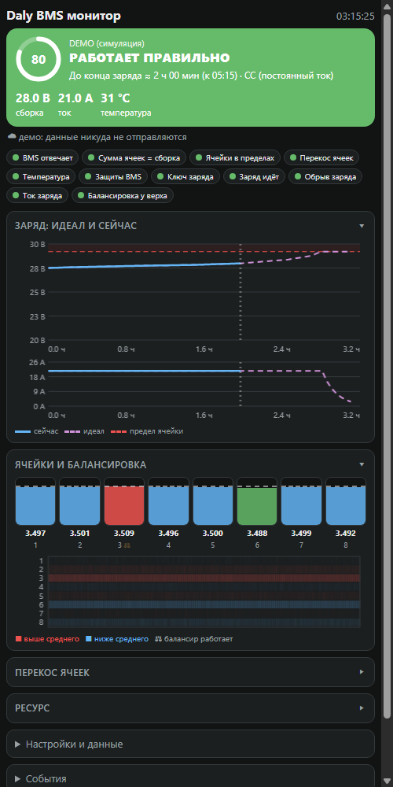
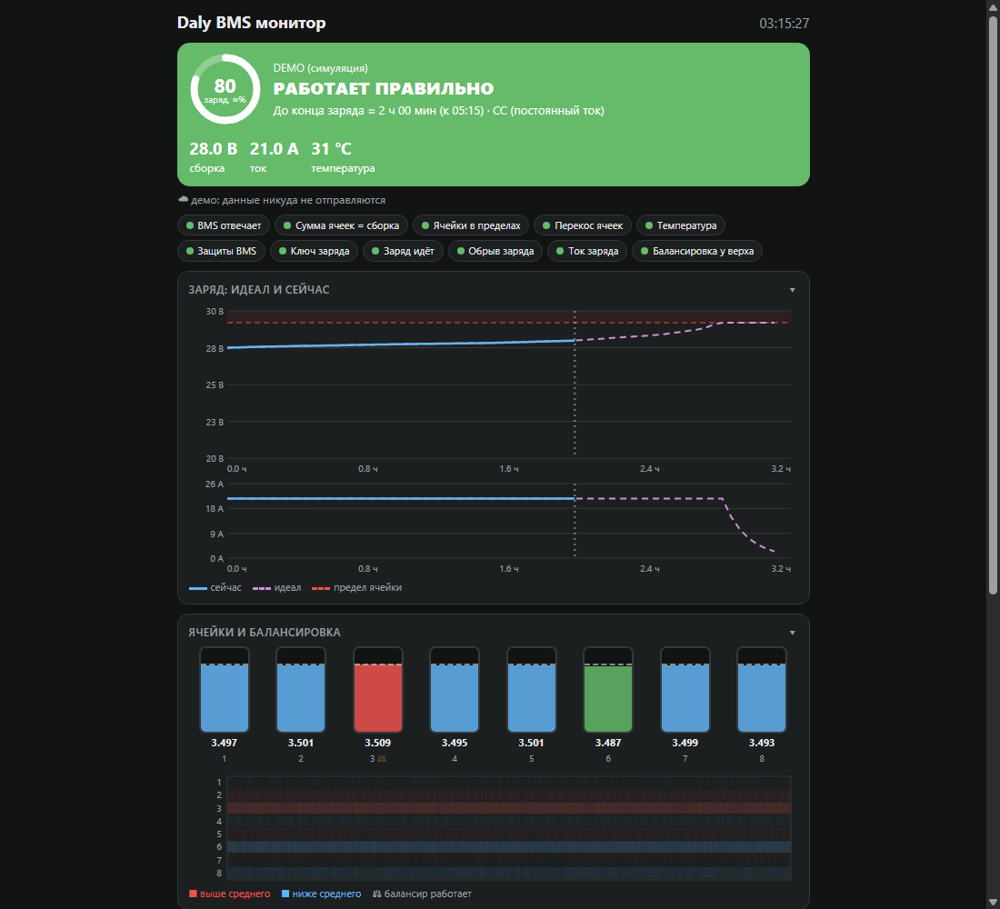

# Daly BMS монитор

Веб-приложение для телефона и компьютера: читает **Daly Smart BMS** с Bluetooth-модулем (имя `DL-…`) и рисует заряд, ячейки, балансировку и проверки. Только чтение: в BMS ничего не пишется.

**Открыть:** https://dropand.github.io/daly-bms-monitor/ — в Chrome на Android (или Chrome/Edge на ПК). Для установки значком: меню Chrome → «Добавить на главный экран».

**Нет BMS под рукой?** Демо с симуляцией: https://dropand.github.io/daly-bms-monitor/?demo (работает в любом браузере).

[English version](README.en.md)

  
  

*Скриншоты сделаны в демо-режиме на симулированных данных.*

## Что показывает
- общий вердикт (работает правильно / внимание / неисправность) и оценку времени до конца заряда;
- график заряда: идеал и реальный (напряжение и ток);
- ячейки, тепловую карту по времени, балансировку, перекос;
- ресурс: циклы, принято и отдано А·ч;
- проверки: ключ заряда, обрыв заряда, защиты, температура, перекос.

## Как пользоваться
1. Включите BMS (экран горит), закройте приложение Smart BMS на телефоне.
2. Нажмите «Добавить BMS», выберите `DL-…`.
3. Задайте химию и ёмкость в «Настройках и данных» (для прогноза и идеальной кривой).
4. История хранится на устройстве (до 48 ч), выгрузка в CSV.

Нужен Web Bluetooth: Chrome на Android, Chrome/Edge на ПК. Safari и iOS не поддерживаются. Страница должна быть открыта на экране: в фоне Chrome связь с BMS не держит.

Нормы (пределы ячейки, ток 0,1–0,3C, кривая заряда) типовые; для вашей модели сверяйте с паспортом. Протокол — открытый Daly UART (команды 0x90–0x98), раскладка битов защит сверена с библиотекой dalybms.

Лицензия MIT.
